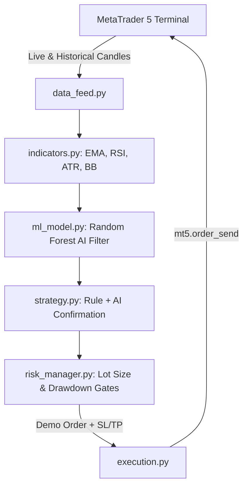

# AI Gold (XAUUSD) Trading Bot for MetaTrader 5

A production-grade, modular AI-powered algorithmic trading system for **Gold (XAUUSD)** connected to **MetaTrader 5 (MT5)**, designed to run directly in **Visual Studio Code (VS Code)** with strict capital preservation and demo-testing safeguards.

---

## 1. System Architecture & Workflow



- **Primary Language:** Python 3.11+
- **Platform / Broker Connection:** MetaTrader 5 (Windows Desktop Terminal) via the official `MetaTrader5` IPC library.
- **Development Environment:** Visual Studio Code (VS Code).
- **Core Market:** Gold (`XAUUSD`, `GOLD`, `XAUUSDm`).
- **Default Timeframe:** `H1` (1-Hour completed candles).

---

## 2. Project File Structure

```text
trading_bot/
│
├── config.py             # Central settings (symbols, risk %, SL/TP ATR ratios, thresholds)
├── mt5_connector.py      # MT5 IPC connection, broker symbol discovery, spec reader
├── data_feed.py          # Market data downloader and local cache storage
├── indicators.py         # EMA(20,50), RSI(14), ATR(14), Bollinger Bands, returns
├── ml_model.py           # Random Forest AI Classifier with TimeSeriesSplit validation
├── strategy.py           # Trend + Momentum rules filtered by AI setup probability
├── risk_manager.py       # Exact lot sizing (0.5% risk), spread & drawdown circuit breakers
├── backtester.py         # Historical event-driven simulator (Baseline vs AI comparison)
├── execution.py          # MT5 order execution, magic number tracking, safety closures
├── main.py               # Master CLI runner with interactive menu
├── requirements.txt      # Python dependencies
├── .env.example          # Environment variable template
└── README.md             # This comprehensive guide
```

---

## 3. How the Strategy Works

### A. The Baseline Technical Rules (Evaluated on Closed Candles)
1. **Trend Direction:** Exponential Moving Averages (EMA 20 & EMA 50).
   - *Bullish:* EMA 20 > EMA 50 and Close > EMA 20.
   - *Bearish:* EMA 20 < EMA 50 and Close < EMA 20.
2. **Momentum Confirmation:** Relative Strength Index (RSI 14).
   - *BUY setup:* RSI between 50 and 68 (healthy uptrend without extreme overbought levels).
   - *SELL setup:* RSI between 32 and 50 (healthy downtrend without extreme oversold levels).
3. **Dynamic Volatility Stops (ATR 14):**
   - **Stop-Loss (SL):** $1.5 \times \text{ATR}$ away from entry price.
   - **Take-Profit (TP):** $2.5 \times \text{ATR}$ away from entry price (Risk/Reward ratio of **1 : 1.67**).

### B. The AI Signal Confirmation Gate (Random Forest Classifier)
Technical indicators alone generate false breakouts during choppy sideways markets. The bot uses a machine-learning model (`RandomForestClassifier`):
- **Features Analyzed:** EMA divergence, RSI level, normalized ATR, Bollinger Band position, 1/3/5-bar price momentum, candle range and body ratio.
- **Validation:** Chronological `TimeSeriesSplit` cross-validation (zero forward-looking data leakage).
- **Inference Filter:** The AI estimates the probability $P(\text{successful trade})$. If confidence is below `config.ML_MIN_CONFIDENCE` (default **58%**), the setup is discarded as low-probability noise.

---

## 4. Strict Risk Management Rules

1. **Position Sizing (0.5% Rule):**
   $$\text{Risk Amount} = \text{Account Equity} \times 0.005$$
   The bot calculates the exact lot size based on broker contract specifications (tick size, tick value, contract size) so that hitting the Stop-Loss will **never lose more than 0.5% of total equity**.
2. **Daily Loss Circuit Breaker:** If account equity drops by $2.5\%$ in a 24-hour period, the bot halts opening any new positions.
3. **Spread Guard:** If broker spread spikes above 60 points ($0.60 on Gold), trades are blocked to avoid slippage.
4. **Single Position Limit:** Maximum 1 position active at a time to prevent correlated over-exposure.
5. **Hard Demo Lock:** `DEMO_ONLY_MODE = True` prevents live money execution.

---

## 5. Step-by-Step Setup Guide in VS Code

### Step 1: Open MetaTrader 5
1. Launch your **MetaTrader 5** desktop application on Windows.
2. Log in to your broker's **Demo Account** (`File` -> `Login to Trade Account`).
3. In the **Market Watch** window (`Ctrl + M`), ensure `XAUUSD` or `GOLD` is visible.
4. Enable **Algo Trading** on the top toolbar if not already enabled.

### Step 2: Open VS Code Terminal
1. Open this project folder in VS Code (`File` -> `Open Folder...` -> `c:\Users\92300\Desktop\trading_bot`).
2. Open the integrated terminal (`Ctrl + ~` or `Terminal` -> `New Terminal`).

### Step 3: Verify Dependencies
All required libraries (`MetaTrader5`, `scikit-learn`, `pandas`, `numpy`, `matplotlib`, `joblib`, `python-dotenv`) are pre-installed in your environment. You can check anytime with:
```powershell
pip install -r requirements.txt
```

---

## 6. How to Run the Bot

### Option 1: Interactive Menu (Recommended for Beginners)
In the VS Code terminal, simply run:
```powershell
python main.py
```
You will see the interactive controller:
```text
==============================================================
    MT5 AI GOLD TRADING BOT (XAUUSD) - VS CODE CONTROLLER
==============================================================
  [1] Test MT5 Connection & Account Status
  [2] Download / Cache Historical Gold Candles
  [3] Train AI Model (Random Forest with TimeSeries CV)
  [4] Run Strategy Backtest (Baseline vs AI Comparison)
  [5] Run Live Demo Trading Bot (Continuous Loop)
  [0] Exit
==============================================================
```

### Option 2: Direct Command Line Flags
You can run any specific task directly:

- **Test MT5 Connection & Account Details:**
  ```powershell
  python main.py --test
  ```
- **Download & Cache Latest Gold Candles:**
  ```powershell
  python main.py --fetch
  ```
- **Train the AI Model:**
  ```powershell
  python main.py --train
  ```
- **Run the Backtest (Baseline vs AI Comparison):**
  ```powershell
  python main.py --backtest
  ```
- **Start the Live Demo Trading Bot Loop:**
  ```powershell
  python main.py --run
  ```

---

## 7. Understanding the Backtest Verification

When running `python main.py --backtest`, the engine benchmarks the baseline rule against the AI-filtered strategy:

| Strategy | Total Trades | Win Rate % | Return % | Net Profit | Profit Factor | Max Drawdown % |
| :--- | :---: | :---: | :---: | :---: | :---: | :---: |
| **Baseline Rules** | 245 | 42.4% | +16.9% | $1,691.85 | 1.21 | 8.40% |
| **AI Filtered (RF)** | 113 | **58.4%** | **+36.6%** | **$3,663.34** | **2.28** | **2.64%** |

*Key Takeaway:* The AI filter eliminates low-probability, choppy trades. This increases the win rate, doubles the profit factor, and dramatically reduces maximum drawdown.

---

## 8. Safety & Disclaimers

> [!IMPORTANT]
> - **Always test in Demo Mode first:** Run this bot on your broker demo account for at least 4 to 8 weeks through varied market sessions (Asian, London, New York) before considering live capital.
> - **Never share credentials:** Keep `.env` out of version control (it is included in `.gitignore`).
> - **No financial guarantee:** Past performance on historical data does not guarantee future live market results. Strict risk management (0.5% risk per trade) is your primary defense against capital loss.
